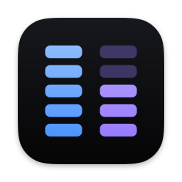
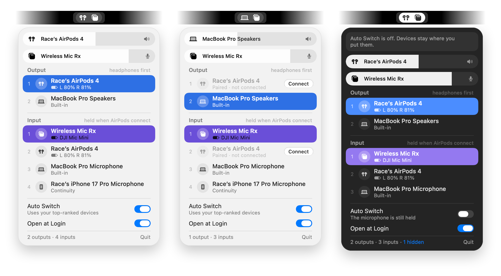

<p align="center">
  
</p>

<h1 align="center">Audio Priority</h1>

<p align="center">
  Keeps your sound on the headphones, speakers and microphone you rank first.
</p>

<p align="center">
  macOS 26 or later &nbsp;·&nbsp; Free and open source
</p>

---

Put in your AirPods and macOS moves your microphone to them too, so the call you joined with a good microphone carries on with a worse one. Unplug a display and the sound lands on whatever macOS picks next.

Audio Priority fixes the order once. It sits in your menu bar with two lists, one for where sound comes out and one for your microphone. Rank your devices, and it switches to the first one that's connected and takes the microphone back whenever macOS or an app moves it.

<p align="center">
  
</p>

- **Your order.** Drag devices into the order you want. Headphones always rank above speakers.
- **Holds your microphone.** When AirPods connect, the sound follows them and your microphone stays where it was.
- **Doesn't fight forever.** If macOS moves the output on its own, Audio Priority switches it back once. If macOS takes it again within 30 seconds it's left there, because every round trip is a gap in the sound.
- **See it at a glance.** The menu-bar item shows the device you hear on the left and your microphone on the right.
- **Hide what you never use.** A hidden device is never chosen for you and keeps its place in the list.
- **Bluetooth from the panel.** Paired devices stay listed while they're off. Click one to connect and use it. AirPods show each bud's battery.
- **Knows when a DJI mic is off.** A DJI Mic Mini's receiver stays plugged in when you switch the mic off. Audio Priority notices, moves to your next microphone, and comes back when the mic is on again. Its row shows the battery.
- **Private.** No account, no tracking, and it never connects to the internet.

## Install

You need macOS 26 or later and [Xcode](https://apps.apple.com/app/xcode/id497799835) 26 or later (free from the App Store). In Terminal, run:

```bash
git clone https://github.com/racejohnson/audio-priority-menubar-app.git
cd audio-priority-menubar-app
make install
```

This builds the app, puts it in your **Applications** folder and opens it. To update later, run `git pull` and `make install` again.

The first time it opens, the devices you're using go to the top of their lists, so nothing switches. **Open at Login** is on from the start.

## Use it

Audio Priority has no Dock icon; it lives in your menu bar. Click the item to open the panel, and click it again to close it.

- **The two bars at the top** show the device in use for output and for input. Drag across one to set the volume or the microphone level.
- **Click a device** to use it. It stays in use until it disconnects or a device ranked above it connects.
- **Drag a device** up or down to change its rank.
- **Hover a device and click ⋯** (or right-click it) to hide it, move it, connect or disconnect it, or move an output between headphones and speakers.
- **The hidden link** at the bottom, such as "1 hidden", shows the devices you've hidden so you can bring one back.
- **Auto Switch**: on, each list uses its first connected device. Off, devices stay where you put them; a device you connect may still take the output, and your microphone is still held.
- **Open at Login**: on by default.
- **Quit**.

The item shows  while Auto Switch is on, and fills in  when it's off.

From the keyboard: Tab moves between devices, Return uses one, and Option-Up and Option-Down change its rank. Esc closes the panel.

## Questions

**Will it change anything when I first open it?**
No. The devices in use go to the top of their lists and stay in use.

**Why did it leave the sound on my AirPods?**
macOS moved the output to them twice within 30 seconds, so Audio Priority stopped switching back. The panel says so. Click the device you want and it switches.

**Does it ever give up on the microphone?**
Only for a moment. If another app takes the microphone back within a second, three times in a row, Audio Priority waits 30 seconds and then takes it again.

**I clicked a device but a different one took over.**
A device you click stays until it disconnects or a device ranked above it connects. Dragging a different device to the top of the list also ends it. Hiding or moving other devices doesn't.

**Why does macOS ask to let it use Bluetooth?**
Only to connect and disconnect devices from the panel. It asks the first time you do that. Battery levels don't need it.

**Why is one of the bars at the top empty?**
That device has no volume or level control of its own, so there's nothing to drag.

**What's "Wireless Mic Rx"?**
The DJI Mic Mini's receiver, by the name macOS gives it. It gets its own symbol.

**How does it know my DJI mic is switched off?**
The receiver broadcasts its state over USB several times a second: whether a mic is linked, its battery level and whether it's charging. Audio Priority only listens; it never sends the receiver anything. A mic that's off for more than three seconds is treated as away. If the receiver ever stops saying anything Audio Priority understands, such as after a firmware change, the mic is simply treated as on.

**Why is there no battery percentage for the DJI mic?**
The receiver reports seven steps from full to nearly empty, not a percentage. The battery mark shows the step, and the row says "Low battery" at the last two.

**How do I start over?**
Quit the app and run `defaults delete com.racejohnson.audio-priority` in Terminal. The lists are rebuilt the next time it opens.

**How do I uninstall it?**
Open the panel, turn off **Open at Login** and click **Quit**. Then drag Audio Priority from Applications to the Trash.

## For developers

It's a Swift package; there's no Xcode project.

```bash
make run        # build a copy in .build and open it
make test       # run the tests for the ranking and switching rules
make dry-run    # run against your real devices without switching, saving or connecting anything
make snapshot   # write pictures of the panel and menu-bar item to .build/snapshots
make selftest   # open the real panel and drive it with synthetic clicks, as a dry run
make readme     # redraw this page's pictures from made-up devices
make icon       # rebuild the app icon from Icon/ (needs rsvg-convert)
```

Builds are signed ad hoc. **Open at Login** only works for the copy in Applications, so use `make install` to try it.

| Path | What |
|---|---|
| `Sources/AudioPriorityCore/` | No CoreAudio here. `SwitchEngine` decides what each role should be on; `PriorityStore` keeps the ranked lists and hidden devices; `DeviceGlyph` maps a device to its symbol; `DJIReceiverFeed` reads the DJI receiver's status |
| `Sources/AudioPriority/` | The app: `AudioSystem` (CoreAudio), `Bluetooth`, `DJIReceiver` (USB, read-only), `AppModel`, the menu-bar item (`StatusItemController`, `Glyphs`) and the panel (`PanelController`, `PanelView`) |
| `Tests/AudioPriorityTests/` | The rules as tests: start here to see what the app promises |
| `Icon/` | The app icon's drawings and build script |
| `docs/` | This page's pictures, redrawn by `make readme` |

Settings live in the app's defaults (`defaults read com.racejohnson.audio-priority`). If saved settings can't be read, the app starts with fresh lists and keeps the unreadable copy under the `settings.unreadable` key.

Left out on purpose: profiles, a mute hotkey, Shortcuts, URL commands, notifications, Jabra support, an update checker. It was built for one Mac: there is no update channel and no notarization.

## License

[GPL-3.0](LICENSE). The switching rules, the headphone keyword list and the Control Center check are from [Audio Priority Bar](https://github.com/camguillory/Audio-Priority-Bar) by Camille Guillory, itself a continuation of [AudioPriorityBar](https://github.com/tobi/AudioPriorityBar) by Tobias Lütke, both GPL-3.0. This app is a smaller rewrite of those rules, not a fork: the code here is new, and the files that carry their logic say so. `PanelController.swift` and `LaunchAtLogin.swift` are from [DayNight](https://github.com/racejohnson/daynight-menubar-app), by the same author.

The DJI receiver's status format was worked out by others and is read here from their notes: [lavdeck](https://github.com/piedol/lavdeck) by piedol, [DJI-Mic-Control](https://github.com/ShadowBitBasher/DJI-Mic-Control) by ShadowBitBasher and [HaloBattery](https://github.com/HeyOkay/HaloBattery) by HeyOkay. The code here is new.

The app icon's direction came from the equalizer icon of [audio-priority](https://github.com/mateusbadalotti/audio-priority) by Mateus Badalotti; the drawing is new. Audio Priority is an independent project, not affiliated with or endorsed by Apple or DJI.
